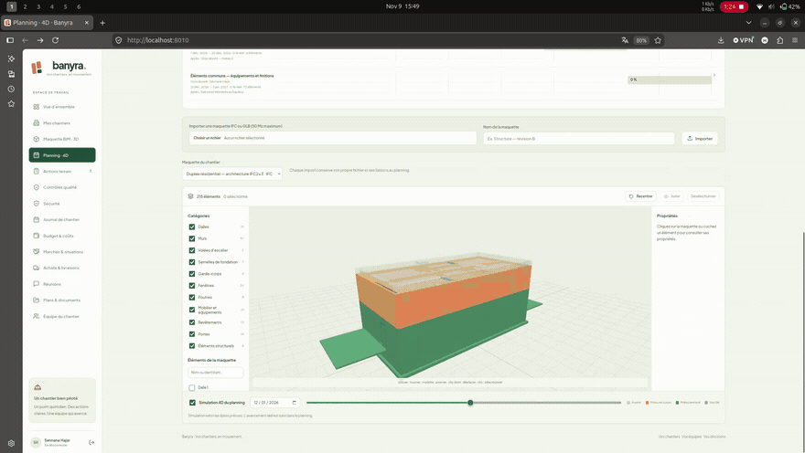
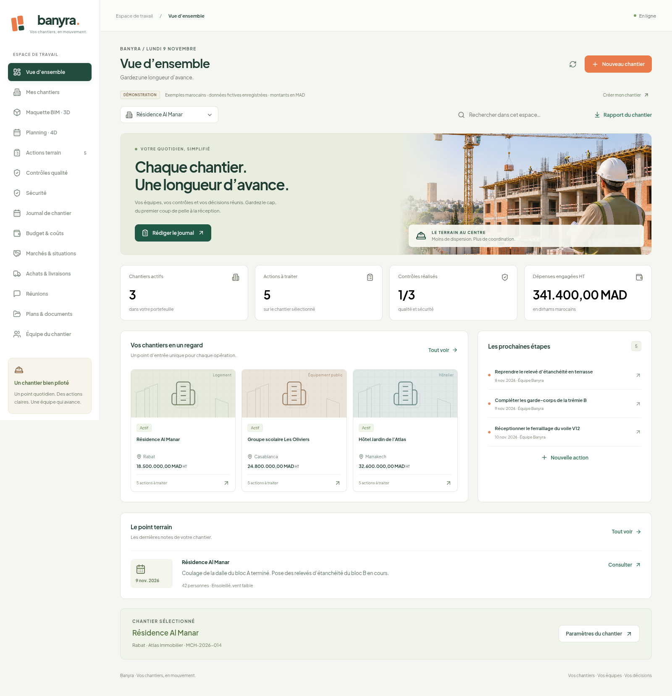
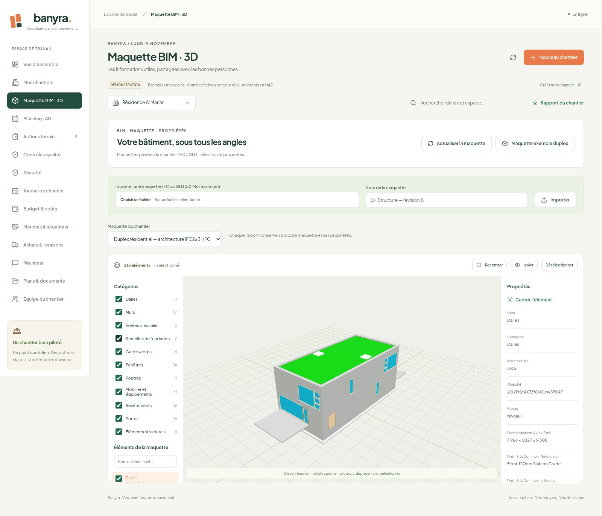
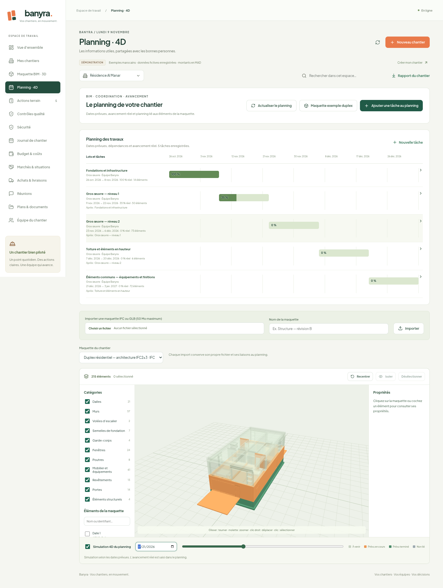

# Banyra

**Banyra est un prototype d’application web destiné au suivi de projets de construction.** Il aide à organiser les informations du chantier, à suivre les tâches et les contrôles, et à relier le planning à une maquette 3D.

Le projet explore l’application du numérique au génie civil, notamment la coordination entre les activités de chantier, les documents techniques, le planning et la maquette BIM.

> **Statut : prototype en cours de développement — ce n’est pas une version finale.** L’interface, les fonctionnalités et les modèles de données peuvent encore évoluer. Les captures et la vidéo présentent l’état actuel du prototype avec des données fictives. Les montants sont exprimés en dirhams marocains (MAD), hors taxes.

La maquette BIM proposée en démonstration est un duplex résidentiel au format IFC2x3. Le fichier source et sa provenance sont documentés dans [THIRD_PARTY.md](THIRD_PARTY.md).

## Pourquoi Banyra ?

Sur un chantier, les informations peuvent être dispersées entre les plans, les fichiers Excel, les échanges WhatsApp et les comptes rendus. Cette dispersion complique le suivi des décisions, des réserves et de l’avancement.

Banyra vise à réunir ces informations dans un même espace pour faciliter le travail des ingénieurs travaux et des équipes chantier. Le prototype associe suivi terrain, maquette BIM et planning, avec une interface en français et des montants en MAD.

L’objectif est de développer progressivement un outil utile au quotidien, en confrontant ses fonctionnalités aux besoins réels des professionnels de la construction au Maroc.

## Démonstration vidéo

Une visite enregistrée de Banyra : vue d’ensemble, inspection de la maquette BIM,
simulation 4D, actions terrain, journal de chantier et suivi des dépenses en MAD.
La vidéo est un enregistrement d’écran fourni par l’autrice du projet, publié sans audio. Les projets et valeurs affichés sont des exemples de démonstration.

[](docs/media/banyra-demo.mp4)

**[▶ Ouvrir la vidéo complète — environ 3 min 15 s (MP4)](docs/media/banyra-demo.mp4)**

## Banyra en images

### Vue d’ensemble du chantier

Chantiers marocains, actions prioritaires, contrôles et dépenses en dirhams réunis sur un tableau de bord.



### Inspection de la maquette BIM 3D

Consultation du duplex IFC, sélection d’un élément, propriétés et filtres par catégorie.



### Planning et simulation 4D

Le planning apparaît au-dessus de la maquette. La date de simulation permet de visualiser le phasage prévu des travaux.



Ces captures et la vidéo proviennent de l’application en fonctionnement. Les données présentées sont des exemples de démonstration.

## Usages pour le suivi de chantier

Banyra regroupe les principales informations nécessaires au suivi d’un projet de construction :

- **Journal de chantier** : consigner les travaux réalisés, les effectifs, la météo, les livraisons, les observations et les blocages.
- **Tâches et réserves** : affecter une action à un responsable, préciser son échéance et sa priorité, puis suivre son avancement.
- **Qualité et sécurité** : enregistrer des contrôles et suivre les points à vérifier avant leur clôture.
- **Documents techniques** : consulter les plans PDF et leurs révisions, joindre des photos et partager des comptes rendus.
- **Suivi des dépenses et des commandes** : consulter le budget et les dépenses, suivre les commandes et leur réception.
- **Marchés et situations** : enregistrer les marchés, les situations mensuelles et les règlements.
- **Coordination de l’équipe** : inviter des utilisateurs et leur attribuer un rôle de responsable, collaborateur ou consultation.

## Maquette BIM et planning 4D

Le module BIM permet de consulter une maquette au format IFC ou GLB, d’inspecter les propriétés des éléments et de filtrer leur affichage.

Dans le planning, les tâches peuvent être reliées aux éléments de la maquette. La simulation 4D permet ensuite de parcourir les dates prévues et de visualiser le phasage des travaux.

1. Ouvrez **Maquette BIM · 3D** pour consulter la maquette exemple ou importer un fichier IFC ou GLB.
2. Ouvrez **Planning · 4D**, créez ou sélectionnez une tâche, puis associez-lui un ou plusieurs éléments de la maquette.
3. Renseignez les dates, le responsable, l’avancement et les dépendances entre tâches.
4. Activez **Simulation 4D du planning** et parcourez les dates.

Les couleurs de la simulation représentent les dates planifiées. L’avancement réel est saisi séparément dans le planning. Le visualiseur nécessite un navigateur récent compatible WebGL. Les fichiers importés peuvent peser jusqu’à 50 Mo.

## Lancer Banyra en local

Prérequis : Python 3.11 ou plus récent et Node.js 22 ou plus récent.

Depuis la racine du projet, exécutez :

```bash
python3 setup.py
python3 run.py
```

Ouvrez ensuite [http://localhost:8010](http://localhost:8010) et créez un compte. À la première ouverture d’un compte vide, des chantiers de démonstration sont proposés avec des données fictives pour Rabat, Casablanca et Marrakech. Vous pouvez aussi créer votre propre chantier depuis **Mes chantiers → Nouveau chantier**.

Après une mise à jour, reconstruisez l’interface avec :

```bash
python3 run.py --build
```

La base SQLite et les pièces jointes sont conservées dans le dossier `data/`.

## Périmètre actuel

La simulation 4D visualise le phasage planifié. Cette version ne calcule pas automatiquement le chemin critique et ne détecte pas les interférences entre éléments de maquette. Le transfert automatique des liens entre les révisions d’une maquette n’est pas disponible.

Les métrés détaillés, les coûts 5D, les annotations de plans, les signatures, les notifications par e-mail et la synchronisation hors connexion ne sont pas inclus dans cette version.

## Axes de développement envisagés

Les évolutions suivantes constituent des pistes pour les prochaines étapes du projet. Elles ne sont pas encore implémentées dans la version présentée.

| Axe | Objectif concret |
| --- | --- |
| **Gestion des stocks** | Suivre les entrées, sorties et transferts de matériaux entre chantiers, réaliser les inventaires et signaler les besoins de réapprovisionnement. |
| **Estimation budgétaire** | Préparer les estimations par lot et corps d’état à partir de quantités et de prix unitaires en MAD, puis comparer le prévisionnel aux dépenses engagées et réelles. |
| **Lecture des plans DWG/DXF** | Importer et consulter les plans 2D, gérer les calques, calibrer l’échelle et relever les dimensions utiles au suivi des travaux. |
| **Avant-métré automatique assisté par IA** | Proposer l’extraction des surfaces, longueurs et volumes à partir des plans et des maquettes, en reliant chaque quantité à sa source pour vérification par l’ingénieur. |
| **Métrés et coûts 5D** | Relier les quantités de la maquette aux lignes du bordereau des prix et du devis, puis suivre l’incidence financière des modifications. |
| **Planning avancé** | Étudier le calcul du chemin critique, le suivi des écarts entre prévisionnel et réalisé, ainsi que les liens entre tâches, approvisionnements et ressources. |
| **Utilisation sur le terrain et hors connexion** | Faciliter la saisie des journaux, photos et réserves sur mobile, puis synchroniser les informations au retour de la connexion. |

Pour l’avant-métré assisté par IA, la vérification de l’échelle, des unités et des quantités par un professionnel fera partie du fonctionnement prévu avant leur utilisation dans une estimation ou un devis.

## Technologies

- **Interface** : React et Vite
- **API** : FastAPI
- **Base de données** : SQLite
- **Déploiement** : Docker Compose et Caddy

Pour un déploiement sur serveur Linux, créez un fichier `.env` à partir de `.env.example`, renseignez `BANYRA_DOMAIN`, puis lancez :

```bash
docker compose up -d --build
```

Prévoyez un volume persistant et sauvegardez ensemble la base de données et les pièces jointes.

Les licences des dépendances sont répertoriées dans [THIRD_PARTY.md](THIRD_PARTY.md).

---

**Projet réalisé par Hajar Sennane**  
Génie civil · Outils numériques appliqués au suivi de chantier et au BIM
